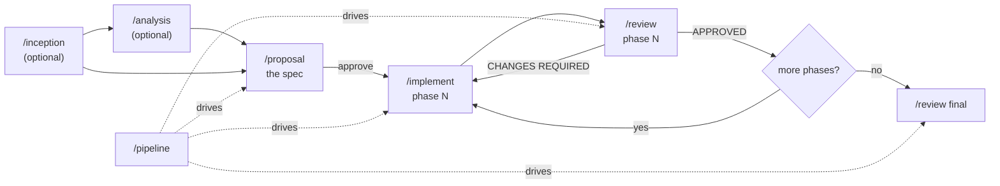

# The Spectionflow workflow

Spectionflow turns an idea into reviewed code through small, document-driven steps. Each skill reads
the previous step's document and writes its own, so the work is auditable and resumable.

## Who does what

- **You decide**: what the product is, which option wins, whether the proposal is approved, what is deferred.
- **The agent executes**: explores the code, drafts documents, implements a phase, reviews with evidence.
- **Documents carry state**: the proposal's status line and the review verdicts say where a feature stands.

## Stages and artifacts

| Stage | Skill | Writes | Reads |
|---|---|---|---|
| Inception | `/inception` | `docs/inception/*`, seed proposals | `docs/inception/sources/` |
| Research | `/analysis` | `docs/features/<Feature>/Analysis_<Feature>.md` | project docs, code |
| Planning + Spec | `/proposal` | `Proposal_<Feature>.md` (with the phased Implementation Plan) | analysis, inception, code |
| Implementation | `/implement` | code and tests for one phase | the proposal |
| Review | `/review` | `Review_Phase_<N>_<Feature>.md`, `Review_Final_<Feature>.md` | the proposal, the code |
| Orchestration | `/pipeline` | `Progress_<Feature>.md` | all of the above |

## Human checkpoints

1. After `/proposal`: you approve (or edit) the spec before any code is written.
2. After each `/review`: you see the verdict; `CRITICAL` findings block progress.
3. After the final review: you decide what to do with the deferred items.

## Going deeper

- [Methodology](methodology.md) — why the workflow looks like this
- [Getting started](getting-started.md) — install and first run
- [Skills reference](skills/README.md) — one page per skill
- [Artifacts reference](artifacts.md) — file layout, ids, statuses, templates
- [Inception](inception.md), [Development](development.md), [Writing executable specs](specification.md)
