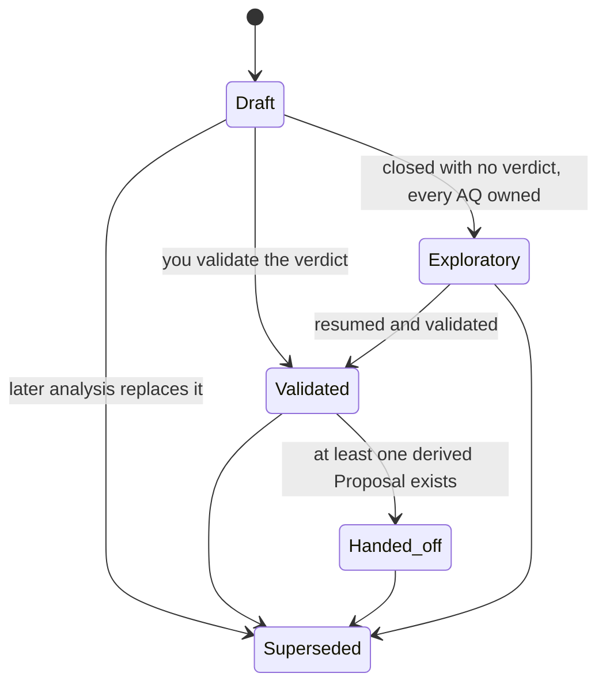
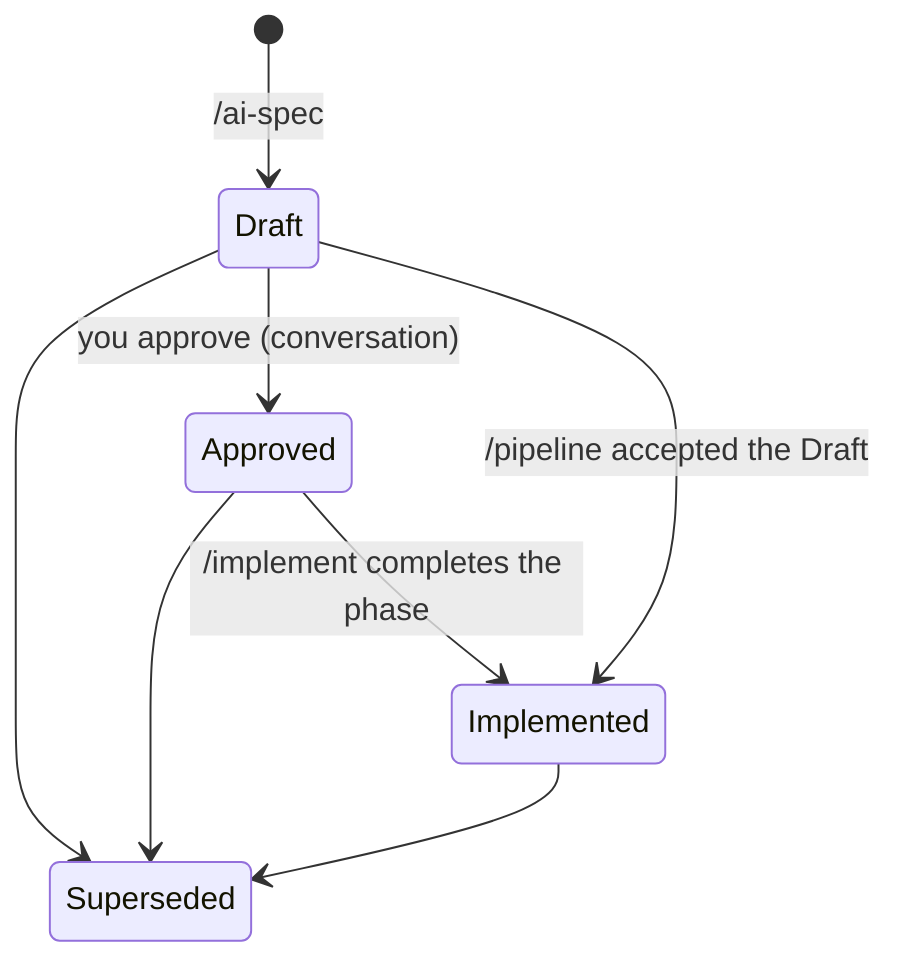
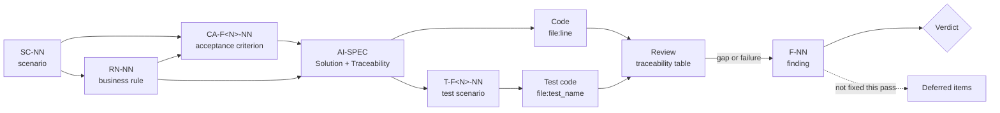

# Artifact reference

Every Spectionflow skill reads and writes plain Markdown files in your repository. This page lists them all: where they live, how they are named, which IDs they use, which statuses they go through, and the exact structure of the four main documents (Analysis, Proposal, AI-SPEC, Review).

## Directory layout

```
docs/
├── inception/
│   ├── README.md
│   ├── Product_Definition.md
│   ├── Scope_and_Milestones.md
│   └── sources/                          # briefs, interviews, old specs you drop in
└── features/
    └── <Feature>/                        # e.g. Notification_Retry
        ├── Analysis_<Feature>.md         # /analysis (optional)
        ├── Proposal_<Feature>.md         # /proposal (what and why, phase roadmap)
        ├── AI-SPEC_<Feature>_Phase_<N>.md # /ai-spec (executable spec, one per phase)
        ├── Review_Phase_<N>_<Feature>.md # /review phase N
        ├── Review_Final_<Feature>.md     # /review final
        └── Progress_<Feature>.md         # /pipeline only (checklist)
```

| File | Written by | Notes |
|---|---|---|
| `docs/inception/README.md` | `/inception init` | Created only if absent. |
| `docs/inception/Product_Definition.md` | `/inception discovery` | Pain, customer, value hypothesis, success signal. |
| `docs/inception/Scope_and_Milestones.md` | `/inception scope` | Milestone 1 and what is out of scope. |
| `docs/inception/sources/` | you | Statements taken from here are tagged `[from-source:<file>]`. |
| `Analysis_<Feature>.md` | `/analysis` | Optional study before the Proposal. |
| `Proposal_<Feature>.md` | `/proposal` (seed by `/inception finalize`) | What and why: rules, criteria, decisions; its Implementation Plan is a phase roadmap. |
| `AI-SPEC_<Feature>_Phase_<N>.md` | `/ai-spec <Feature> phase N` | How, for one phase; one file per phase (`Phase_1` even for a single-phase feature). |
| `Review_Phase_<N>_<Feature>.md` | `/review <Feature> phase N` | One per phase; a re-review keeps the earlier pass in a revision-history table. |
| `Review_Final_<Feature>.md` | `/review <Feature> final` | Cross-phase review. |
| `Progress_<Feature>.md` | `/pipeline` | Human-readable checklist. No other skill depends on it. |

## Naming rules

- `<Feature>` is `PascalCase_With_Underscores`, for example `Notification_Retry`.
- Features live directly under `docs/features/`. There is no module level.
- The prefix (`Analysis_`, `Proposal_`, `AI-SPEC_` (suffixed `_Phase_<N>`), `Review_Phase_<N>_`, `Review_Final_`, `Progress_`) is mandatory, and the feature name is part of every file name. Because the name carries the feature, reviews of two features can never overwrite each other.
- A review skill never overwrites a `Review_*` file it did not produce in the current run; it picks a distinct suffix and says so.
- Dates come from the shell `date` command, never from memory. There is no activity-log file.

## ID schemes

IDs are **stable**: once published they are never renamed, renumbered or reused. New items take the next number. Review and test traceability depends on this.

| Prefix | Meaning | Defined in | Format / example |
|---|---|---|---|
| `SC-NN` | Scenario to address (problem section) | Proposal section 1 | `SC-01` |
| `P-NN` | Guiding principle | Proposal section 2 | `P-01` |
| `RN-NN` | Business rule: testable, states violation behavior (in the AI-SPEC: also severity and boolean expression) | Proposal section 5, AI-SPEC section 4 | `RN-01: ... Violation: ...` |
| `R-NN` | Risk | Proposal section 9 | `R-01` |
| `D-NN` | Design decision (why a choice was made) | Proposal section 11 | `D-01` |
| `B-NN` | Expected benefit (resolves `SC-NN`) | Proposal section 12 | `B-01` |
| `CA-F<phase>-NN` | Acceptance criterion of a phase (high level in the Proposal; refined into verifiable form in the AI-SPEC) | Proposal section 13, AI-SPEC section 13 | `CA-F1-03` |
| `CA-FINAL-NN` | Cross-phase / final acceptance criterion | Proposal section 13 | `CA-FINAL-01` |
| `T-F<phase>-NN` | Test scenario of a phase, mapped to RN and CA | AI-SPEC section 10 | `T-F1-01` |
| `INV-NN` | Domain invariant of an entity, as a predicate | AI-SPEC section 4 | `INV-01: quantity > 0` |
| `AQ-NN` | Open question, with an owner | Analysis section 7, Proposal section 15 | `AQ-01` |
| `F-NN` (in an Analysis) | Candidate feature, `discovery` mode only | Analysis section 3 | `F-01` |
| `F-NN` (in a Review) | Finding with severity | Review section 10 | `F-01` |
| `N1..Nk`, `D1..Dk` | Taxonomy levels (`strategic`) and remediation phases (`rca`) | Analysis section 3 | `N2`, `D1` |

The two `F-NN` families live in different documents (an Analysis catalog entry versus a Review finding); the file they appear in tells them apart.

The `P-NN`, `R-NN`, `B-NN` and `SC-NN` ids only exist in the Proposal. The ones that drive traceability across documents are `RN`, `CA`, `T`, `AQ` and `F`. The AI-SPEC uses the Proposal's `RN` and `CA` ids verbatim and adds `T` and `INV`; it never renumbers them.

### Open-question owners (`AQ-NN`)

| Owner | Meaning |
|---|---|
| `operator` | You must answer before approval. |
| `proposal` | The Proposal answers it before it is finalized. |
| `spike` | Needs a timeboxed experiment first. |
| `deferred` | Consciously postponed, with reason and trigger; tracked outside the document (for example your issue tracker). |

A question may be answered inline (the answer goes in "Answer"; the owner stays). A question that became obsolete is struck through with a reason and has no owner.

## Status vocabularies and lifecycle

### Analysis

`Draft` | `Exploratory — no decision` | `Validated` | `Handed-off` | `Superseded`



(`Handed_off` is `Handed-off` and `Exploratory` is `Exploratory — no decision` in the document.) There are no other transitions and no automatic or timed ones. `Superseded` is applied with a banner at the top; the body is never rewritten.

### Proposal

`Draft` | `Approved` | `In Progress` | `Implemented` | `Superseded` (an inception seed carries `Seed (from Inception)` until `/proposal` expands it).

```mermaid
stateDiagram-v2
    [*] --> Seed: /inception finalize
    Seed --> Draft: /proposal expands it
    [*] --> Draft: /proposal
    Draft --> Approved: you approve (conversation)
    Approved --> InProgress: /implement phase 1 starts
    InProgress --> Implemented: final review passes
    Draft --> Superseded
    Approved --> Superseded
    InProgress --> Superseded
    Implemented --> Superseded
```



Rules: `Approved` is set only when you approve in the conversation; `/implement` may change only the Status line (to `In Progress`, at phase 1); `/pipeline` sets `Implemented` after a passing final review.

### AI-SPEC

`Draft` | `Approved` | `Implemented` | `Superseded`



Rules: `/ai-spec` always writes `Draft`; `Approved` is set only when you say so; `/implement` may change only the Status line, to `Implemented`, when the phase is complete. `/pipeline` can accept a Draft AI-SPEC and carry on (see [pipeline](skills/pipeline.md)).

### Review

Verdict: `APPROVED` | `APPROVED WITH OBSERVATIONS` | `CHANGES REQUIRED`.

| Verdict | Condition |
|---|---|
| APPROVED | Zero CRITICAL, zero MAJOR; all tests pass; all in-scope acceptance criteria PASS. |
| APPROVED WITH OBSERVATIONS | Zero CRITICAL, zero MAJOR; MINOR findings or observations exist. |
| CHANGES REQUIRED | Any CRITICAL or MAJOR finding, any acceptance criterion FAIL, or any failing test. |

Severities: `CRITICAL` (blocks merge), `MAJOR` (blocks merge), `MINOR`, `OBSERVATION`.

Per-item vocabularies inside a review:

| Item | Values |
|---|---|
| Spec deviation class | MISSING (CRITICAL), DIVERGENT (MAJOR), EXTRA (MINOR) |
| Business-rule verdict | COVERED, UNTESTED (MAJOR), PARTIAL, MISSING (CRITICAL) |
| Acceptance criterion | PASS, FAIL, NOT VERIFIABLE (in `/pipeline` verification also: NOT VERIFIED (needs execution)) |
| Cross-layer row | ALIGNED, DRIFT |
| Static check | PASS, FAIL, NOT RUN (never counted as PASS) |
| Guard (mutation) | proven, no discriminating test (MAJOR) |

A phase review never emits PASS or FAIL on a `CA-FINAL-*` criterion; only the final review does.

## Document templates

### Analysis

Exactly nine sections in this order. A section that does not apply says so explicitly; it is never omitted. The prose follows your project's documentation language; the headings below stay in English.

```markdown
# Analysis — <Feature>

**Type**: discovery | capability | decision | strategic | rca | item
**Date**: YYYY-MM-DD
**Status**: Draft | Exploratory — no decision | Validated | Handed-off | Superseded
**Related**: decision records, features, inception docs, proposals

> This document is **not** a proposal. It is the study that precedes one. It implements nothing.

## 1. Question under analysis
## 2. Current state
## 3. <Mode body>
## 4. Verdict / Recommendation
## 5. Architecture fit
## 6. Risks of the recommendation
## 7. AQ — Open questions
## 8. Handoff
## 9. Sources
```

- Each section starts with at least one line of prose before any sub-heading.
- Section 2 uses real, verified paths (never placeholders).
- Section 3 depends on the mode: catalog of `F-NN` candidates (`discovery`), inventory and gap table (`capability`), options x criteria matrix with recommendation (`decision`), taxonomy `N1..Nk` with verdicts (`strategic`), causal chain with `path:line` plus plan `D1..Dk` (`rca`), requirements as received plus interpretation and decisions (`item`).
- Section 4 may say "Exploratory — no decision".
- Section 5 describes what runs where (local vs. shared/central) if the project distinguishes; otherwise one line "N/A".
- Section 7 bullet format: `- **AQ-NN** — <question>. **Owner**: <owner>. **Answer**: <inline, once resolved>`. Ids sequential from `AQ-01`, no gaps or duplicates, never renumbered.
- Section 8 is mandatory and never empty: `/proposal <X>[, <Y>...]`, a decision record candidate, a deferred item, or `none — archived` plus one sentence of justification.

### Proposal

The Proposal is the **what and why**. Header, then sections 1 to 15, plus an optional Glossary. A section is omitted only if it genuinely does not apply, and then one line says so.

```markdown
# Proposal: {Title} - {Subtitle}

**Date**: YYYY-MM-DD
**Status**: Draft | Approved | In Progress | Implemented | Superseded
**Affected areas**: {real modules/layers/surfaces of the project}
**Prerequisites**: {features/modules that must exist, with status: Implemented / In progress / Pending}
**External dependencies**: {libraries, APIs, services with exact versions, or "None new"}
**Estimated complexity**: Low | Medium | High | Very High
```

| # | Section | Content |
|---|---|---|
| 1 | Problem and Motivation | Current state and limits with real paths; scenarios `SC-01...`; consequences of doing nothing; cites Inception/Analysis if any. |
| 2 | Solution Overview | 1-3 paragraphs and a diagram; principles `P-01...`; In scope / Out of scope with a justification for each exclusion. |
| 3 | Current State | Table: Aspect, State (Exists / Partial / Missing), Path / reference. What is stub vs. implemented; what must be modified. |
| 4 | Proposed Architecture | Data model (real schema syntax), data flow and sequence diagrams, integrations, components (file tree, endpoints/operations table, UI views), alternatives (Options A/B/C with a recommendation). |
| 5 | Business Rules | `RN-01...` grouped by sub-domain; each testable, with `Violation:` behavior. |
| 6 | Security and Access Model | Authn/authz, data isolation, sensitive fields, input validation, leak scenarios. Only what applies to the project. |
| 7 | Performance and Scalability | Frequent queries and indexes, pagination defaults and maximums, N+1 risks, data volume, caching. |
| 8 | Impact Analysis | Table of changed files/modules (change type, risk, description); breaking changes; migration path; rollback; what becomes obsolete (or "Nothing becomes obsolete"). |
| 9 | Risks and Mitigations | Table `R-01...`: risk, probability, impact, mitigation. |
| 10 | Observability | Events emitted, what is logged, metrics worth measuring. |
| 11 | Design Decisions | `D-01...`: why each key choice; decisions inherited from the Analysis and any divergence. |
| 12 | Expected Benefits | `B-01...`: each resolves `SC-NN` and states how success is observed (a real measure or an honest "not measurable because ..."). |
| 13 | Acceptance Criteria | `CA-F<phase>-NN` per phase and `CA-FINAL-NN`; coverage of happy paths, errors, authorization, isolation, i18n, performance where applicable; test-suite criteria name their baseline. |
| 14 | Implementation Plan | Phase **roadmap only**, one table: Phase, Name, Goal, Scope summary, Acceptance criteria covered, Depends on, Size (S / M / L). No file-level detail: that lives in the AI-SPEC of each phase. |
| 15 | Open Questions | `AQ-NN` with question, owner and status. |
| - | Glossary (optional) | Only domain-specific or ambiguous terms. |

Required properties: every `RN-NN` covered by at least one `CA`; every `CA` traces to at least one `SC`; no placeholder text ("TBD", "similar to X", "etc.", "as needed"); every cited path is real.

### AI-SPEC

The **how**, for one phase, precise enough that an agent implements it without asking. Fifteen sections, exact headings, in this order. A section that does not apply stays, with one line saying why.

```markdown
# AI-SPEC: <Title> - Phase <N>: <Phase name>

**Feature**: <Feature>
**Phase**: <N> of <M>
**Status**: Draft | Approved | Implemented | Superseded
**Date**: YYYY-MM-DD
**Proposal**: docs/features/<Feature>/Proposal_<Feature>.md
**Related**: <previous/next phase specs, analysis, decision records - or "None">
```

| # | Section | Content |
|---|---|---|
| 1 | Description | What the phase delivers and why; numbered capabilities. |
| 2 | Scope | In scope; Out of scope, each item with a reason and where it goes. |
| 3 | Current State | Verified table (Aspect, State, Path); what is stub, missing, or must be modified. |
| 4 | Solution | In execution order: overview diagram; files (`MODIFY` marked); data model with invariants `INV-NN`; contracts; business rules `RN-NN [BLOCK\|WARN\|INFO]` with `Holds when:` (boolean expression) and `Violation:`; state machine with guarded transitions (`From -> To [guard] (actor/event)`, unlisted transitions forbidden); flows; error table; limits of each guarantee. |
| 5 | Interface | Screens, commands or public API; states; wireframes. Or "No interface in this phase." |
| 6 | Integrations | Direction, endpoint/event/function, payload; idempotent handlers. |
| 7 | Security | Access per entry point (restrictive by default), data isolation, data-sensitivity table. |
| 8 | Performance | Indexes and the query each serves; pagination limits; N+1 risks; numbers and units. |
| 9 | Observability | Telemetry; append-only audit for sensitive or state-changing actions (actor, action, target, before -> after, timestamp, reason). |
| 10 | Tests | Scenarios `T-F<phase>-NN` (level, RN, CA, Given / When / Then / Assert); exact commands to run. |
| 11 | Migration / Seed | Migration (flagged if destructive), idempotent seed data, new configuration. |
| 12 | Dependencies | New packages with version range and justification. |
| 13 | Acceptance Criteria | `CA-F<phase>-NN` refined to pass/fail, each with its verification method. |
| 14 | Traceability | Table: Requirement (Proposal), RN, CA, Test, File / area. |
| 15 | Self-check | What was searched and how (at least 3 cited items), the candidate-collision table, and `self-check: candidates=<N> real=<A> self-inflicted=<B> discarded=<C>`. |

Required properties: every CA has a test; every RN appears in Solution and in a test (one violating-case scenario and one holding-case scenario); every transition and invariant is exercised; every cited path is real; no `TODO`, `TBD`, "etc." or "similar to X"; every count recounted. While writing, a draft carries the line `> SKELETON - body pending` under the header; removing it marks the document as complete. Writing guide: [`/ai-spec`](skills/ai-spec.md).

### Review

Phase reviews are named `Review_Phase_<N>_<Feature>.md`, the final review `Review_Final_<Feature>.md`. The document starts exactly with:

```markdown
# Review - <Feature> - Phase <N>: <subtitle>    (or: Review Final - <Feature>)

**Date**: YYYY-MM-DD
**Proposal reviewed**: <path>
**AI-SPEC reviewed**: <path(s)>
**Phase / scope**: <phase N | final>
**Verdict**: <filled at the end, identical to section 10>
```

| # | Section | Content |
|---|---|---|
| 1 | Spec compliance | 1.1 AI-SPEC compliance (Scope, Solution items, Traceability table; deviations MISSING / DIVERGENT / EXTRA); 1.2 Proposal alignment (rules not weakened, decisions, principles, silently resolved open questions). |
| 2 | Business-rule traceability | Table per `RN-NN`: Implemented?, File:line, Tested?, Test. Verdicts COVERED / UNTESTED / PARTIAL / MISSING. |
| 3 | Acceptance criteria | 3.1 per-phase `CA-F<N>-NN` (PASS / FAIL / NOT VERIFIABLE with evidence); 3.2 `CA-FINAL-*`; 3.3 summary table. |
| 4 | Code review | Severity scale; 4.1 architecture and patterns; 4.2 data isolation (if applicable); 4.3 security; 4.4 code quality; 4.5 error handling. |
| 5 | Cross-layer consistency | Table From / To / Check, each row ALIGNED or DRIFT. |
| 6 | Migrations and seeds | Only if the project has them. |
| 7 | Testing validation | 7.1 unit and integration; 7.2 end-to-end; 7.3 completeness table; 7.4 planned test scenarios (`T-F<N>-NN`) exist; 7.5 invariant guards (mutation sampling, mandatory); 7.6 duplicated catalogs; 7.7 test doubles for third-party dependencies. |
| 8 | Static analysis and build | Lint, type check, formatting check, schema, build; table with status, errors, warnings. |
| 9 | Documentation and best practices | API docs, database, API design, interface UX, performance, events, dependencies. |
| 10 | Findings register and verdict | Findings `F-NN` with severity, section, description, `File:line`, suggested fix (not applied); verdict; statistics; positive highlights; what to do with findings; **Deferred items**. |

Sections 4.2, 6, 7.6 and 7.7 apply only when the project has the matching feature; the others are always present. The Deferred items section is always present, even if it says "none". Each deferred item has an id, a one-line description, the reason for deferral, a severity and what would resolve it.

## Traceability

The chain a reviewer follows, and the ids that tie it together:



How to read it:

1. A scenario (`SC-NN`) motivates one or more business rules (`RN-NN`) in the Proposal.
2. Each rule is covered by at least one acceptance criterion (`CA-F<N>-NN`), and each criterion traces back to a scenario.
3. For each phase, `/ai-spec` turns rules and criteria into a design: each rule gets a severity and a boolean expression, each criterion a verification method, and each test scenario an id `T-F<N>-NN` mapped to the rules and criteria it covers. Its Traceability table links requirement, RN, CA, test and file/area.
4. `/implement` enforces each rule in code and writes the tests listed in the AI-SPEC.
5. `/review` checks the code against the AI-SPEC and the Proposal. It builds one row per rule (`File:line`, test) and grep-checks that every `T-F<N>-NN` exists. A missing implementation is a CRITICAL finding, an untested rule is a MAJOR finding.
6. Findings (`F-NN`) feed the verdict. Anything not fixed in the pass goes to the Deferred items section so it is not lost.
