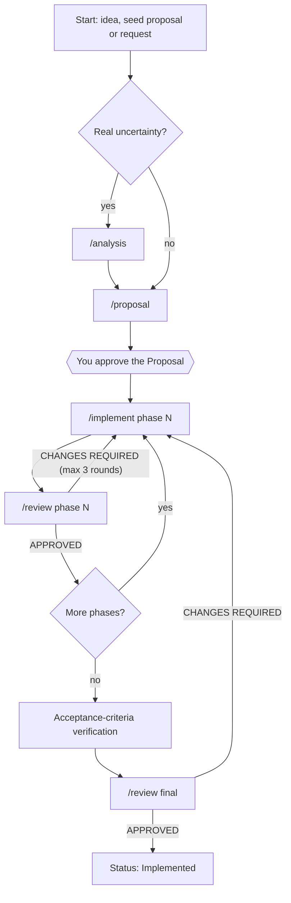

# Development: the per-feature loop

Development turns one feature (or refactoring, or extra feature) into reviewed code. It runs once per feature, phase by phase. See [methodology.md](methodology.md) for where it sits in the lifecycle.



## 1. Research (optional)

Run `/analysis <theme>` when the feature carries real technical or decision uncertainty: several viable approaches, a bug with an unknown cause, a territory you do not know. It produces `Analysis_<Feature>.md` with a verdict (or an honest "Exploratory, no decision"), open questions `AQ-NN` with owners, and a handoff to `/proposal`.

Skip it when the requirement is already clear. `/proposal` still explores the code itself before writing.

## 2. Proposal: planning and spec

`/proposal <Feature>` explores your project (README, `CLAUDE.md`/`AGENTS.md`, manifests, existing code and docs), then writes the single spec. Two parts matter for the loop:

- the **business rules and acceptance criteria**, which define "correct" (see [specification.md](specification.md));
- the **Implementation Plan**, which defines the phases.

**You must approve the Proposal** before implementation. Answer every open question owned by `operator`. Edit the document directly if something is wrong; the skills treat your edits as authoritative.

### Sizing phases

Each phase should be:

- **implementable and reviewable in one cycle**: one `/implement` run, one `/review` run;
- **independently deployable**: it leaves the system working, with no half-built feature exposed;
- **bounded**: a limited set of files and layers, listed explicitly;
- **verifiable alone**: it has its own acceptance criteria and validation commands;
- **ordered** so later phases depend only on earlier ones.

A small feature can be one phase. If a phase needs more than a handful of deliverables or touches many unrelated areas, split it. More than five phases in one run is a warning sign: do them in batches.

Each phase in the plan states: goal, deliverables, files/areas, tests to write (mapped to business rules), acceptance criteria covered, and exact validation commands.

## 3. Implement one phase

`/implement <Feature> phase N` (no phase given: the first one not yet implemented).

What it does, in order:

1. **Prepares.** Reads the whole Proposal and the phase, checks prerequisites, learns your build/test/lint commands, studies a similar existing module to copy real patterns. If an earlier phase or an open question blocks it, it stops and tells you. It sets the Proposal status to `In Progress` on phase 1 and changes nothing else in the Proposal.
2. **Builds in a fixed order**, each step passing its checks before the next: data, contracts, logic, entry points, wiring, build gate, tests, interface, interface gate. Layers your project does not have are skipped.
3. **Controls scope.** Only what this phase describes. No future-phase work, no drive-by refactoring. Ambiguity means asking, not guessing.
4. **Proves its guards.** For every guard it adds (a validation, a limit, an authorization check), it temporarily removes the guard and confirms a test fails, then restores the file and compares checksums. Coverage shows a line ran; this shows a test notices.
5. **Reports**: what was built per deliverable and criterion, commands run and results, anything unproven, and **deferred items** it noticed but did not do.

It ends by telling you to run `/review <Feature> phase N`.

## 4. Review one phase

`/review <Feature> phase N` compares the code to the Proposal and writes `Review_Phase_<N>_<Feature>.md`.

- It reads the Proposal, earlier reviews and **every new or modified file** in full, and runs the build, lint, type-check and tests itself.
- It traces each business rule and each acceptance criterion to evidence (file, line, test, command output).
- It classifies deviations as **MISSING** (specified, absent), **DIVERGENT** (implemented differently) or **EXTRA** (not specified).
- It samples guards by mutation, as `/implement` does, to check tests would catch a regression.
- Findings have an id (`F-NN`) and a severity: **CRITICAL**, **MAJOR**, **MINOR**, **OBSERVATION**.
- The verdict is **APPROVED**, **APPROVED WITH OBSERVATIONS** or **CHANGES REQUIRED**.
- Leftovers go in a **Deferred items** section of the review file.

The reviewer never edits code. For a trivial fix it writes a suggested diff inside the finding.

## 5. The fix loop

On `CHANGES REQUIRED`:

1. Run `/implement <Feature> phase N` pointing at the review file. It fixes exactly the listed findings and nothing else.
2. Re-run build and tests.
3. Run `/review` again. The new pass keeps the previous verdict in a revision-history table.
4. Repeat until `APPROVED` or `APPROVED WITH OBSERVATIONS`.

Branch on the **verdict**, not on the CRITICAL count: a MAJOR finding or a failing criterion also produces `CHANGES REQUIRED`.

With `/pipeline` the loop is bounded to **3 fix rounds** per phase. If the third round still fails, it stops and gives you the remaining findings, what was tried, and your options: grant more rounds, change the approach, amend the Proposal, or abort. Without `/pipeline`, apply the same discipline yourself.

## 6. Amend the Proposal when reality disagrees

If a phase or a review shows that the Proposal asserted something false (an unimplementable mechanism, a rule already implemented, a wrong count), fix the Proposal **now**, with an amendment note that keeps the original text and says what is true and which phase showed it. Later phases then read a correct document.

## 7. Acceptance verification and final review

After all phases (scope `all` in `/pipeline`):

1. **Acceptance-criteria verification.** Each `CA-F<phase>-NN` and `CA-FINAL-NN` is checked for evidence in the repository: files, entry points, tests. Every test id cited as evidence is searched for; a cited test that does not exist means the criterion is not covered. Criteria that need a running app, a real credential or a third-party call are marked **NOT VERIFIED (needs execution)** and are never counted as passed.
2. **Final review**: `/review <Feature> final` covers integration between phases, cross-cutting concerns (security, performance, observability, data isolation if relevant), overall criteria, and duplication or contradictions across phases. It writes `Review_Final_<Feature>.md`.
3. Fix `CRITICAL`, `MAJOR` and `MINOR` findings through `/implement` (up to 3 rounds), then re-review.
4. When the final review passes, the Proposal status becomes `Implemented`.

A criterion that was not verified is not "almost passed". The feature delivers what it delivers, and that part was not seen working.

## Using `/pipeline`

```
/pipeline Notification_Retry all        # every phase, with checkpoints
/pipeline Notification_Retry phase 2    # only phase 2 (skips cross-phase steps)
/pipeline Notification_Retry resume     # continue from the first incomplete step
```

`/pipeline` orchestrates; it never writes a proposal, code or review itself. It derives state from the artifacts (Proposal status, review verdicts), not from memory, so it can resume after any interruption. It also keeps a human-readable `Progress_<Feature>.md` checklist that no other skill depends on. Gates: no implementation without an approved Proposal, and no phase counts as done without a review file whose verdict is APPROVED or APPROVED WITH OBSERVATIONS.

## Refactoring and extra features

Refactorings, improvements and unplanned features use the same loop. Start at Research or Proposal, never at Implementation.

For a **refactoring**: write the Proposal around behavior preservation. Business rules say what must not change; acceptance criteria are existing behavior pinned by tests (write those tests in phase 1 if they do not exist); later phases migrate in steps that each leave the system working. Use `/analysis` in `rca` or `decision` mode when the cause or the target design is unclear.

## Anti-patterns

- ❌ Implementing without an approved Proposal.
- ❌ A phase too large for one implement/review cycle.
- ❌ Asking `/implement` for several phases at once, or letting it "also fix" things nearby.
- ❌ Letting the reviewer fix code, or the implementer declare its own phase approved.
- ❌ Editing the Proposal silently to match what was built. Amend with a visible note.
- ❌ Acceptance criteria like "the suite is green". Name a baseline: "no new failure relative to the baseline recorded at the start".
- ❌ Counting unverified criteria as passed.
- ❌ Looping on fixes forever. Stop after three rounds and decide as a human.
- ❌ Skipping Research on a feature whose approach is genuinely unknown.
- ❌ Treating the chat as the spec. If a decision matters, it is in the Proposal.
