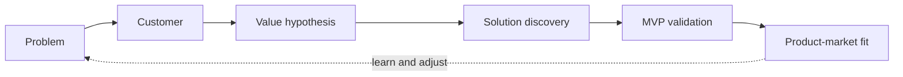

# Inception: deciding what to build

Inception is the discovery stage. It answers **what** to build first, **for whom**, and **how you will know it worked**, before any feature is specified. It is an interactive loop: the human decides, the AI researches, drafts and asks.

This page covers the concepts, then exactly what the `/inception` skill does and does not do. See also [methodology.md](methodology.md).

## What a good inception delivers

- A product definition: pain, customer, value hypothesis.
- A scope: the first milestone, small enough to test the hypothesis.
- Requirements and decisions that are unambiguous **for the first phase at least**. Later phases need not be detailed yet; they can be refined when they start.

Rule of thumb: stop when the first phase can be handed to `/proposal` without questions.

## Product discovery and product-market fit

Discovery reduces uncertainty until there is evidence of real, repeatable demand.



| Step | Question | Typical evidence |
|---|---|---|
| **Problem discovery** | Is the pain real, relevant and recurring? | Interviews, observation, process and cost analysis |
| **Customer discovery** | Who suffers most? | An ideal customer profile and a first segment to serve |
| **Value hypothesis** | What outcome does the customer want? | `If we offer X, the customer gets Y, with impact Z` |
| **Solution discovery** | Would they actually use this? | Prototypes, mockups, manual ("concierge") versions |
| **MVP validation** | Does it create value in real use? | Active pilot, recurring use, willingness to pay, retention |
| **Product-market fit** | Does a specific segment keep using it because it solves an important pain better than the alternatives? | See signals below |

The value hypothesis describes an **outcome**, not a feature. "Real-time authorization of purchases, so fraud drops by 3 to 5 percent" is a hypothesis; "an authorization API" is not.

**Signals of fit**: customers keep using the product without incentives, losing it would hurt, referrals happen on their own, usage is recurring, willingness to pay grows, churn is low. A practical B2B test: the customer says "we can't operate without this" or "this became part of our process".

Do not scale before fit. Growth work on an unvalidated product is waste.

## Defining scope

Scope is the value hypothesis turned into the **smallest set of capabilities that tests it**. It is not a feature list.

Form: **segment + pain + situation + outcome + minimal solution**.

A good scope:

- solves one central pain for one clear segment;
- delivers a measurable outcome;
- can be adopted on its own;
- allows recurring use.

Not scope (post-fit material): the complete backlog, the whole product vision, a long roadmap, a full platform, broad integrations.

You can narrow scope along four axes: which part of the problem, which segment first, at which moment of the customer's workflow, which outcome.

## Requirements refinement and Definition of Ready

Refinement turns an intention into work that can be executed: break large items down, remove ambiguity, state acceptance criteria, find rules and exceptions, expose dependencies, order by priority.

An item is **ready** (Definition of Ready) when:

- the business value is clear;
- the description is understandable;
- acceptance criteria are defined and testable;
- the scope is bounded;
- dependencies are known;
- it is small enough to build in a phase.

Anti-patterns: a huge unrefined backlog, vague stories, missing criteria, epics reaching development, hidden dependencies, refining only at planning time.

In Spectionflow, **`/proposal` is where a feature is refined to ready**: its business rules, acceptance criteria and phased plan are the Definition of Ready, checked by its own quality checklist. Inception only has to get you to a bounded Milestone 1.

## The `/inception` skill

`/inception` is deliberately **lightweight**. It covers the minimum to define a first milestone and give `/proposal` product context.

### Sub-modes

| Command | Does | Writes |
|---|---|---|
| `/inception init <sketch>` | Creates the folders, records the product name and sketch, lists and reads the source files | `docs/inception/README.md`, `docs/inception/sources/` |
| `/inception discovery` | Up to 5 questions, one at a time: pain, customer, value hypothesis, how you will know it worked | `docs/inception/Product_Definition.md` |
| `/inception scope` | Proposes Milestone 1 and asks for approval | `docs/inception/Scope_and_Milestones.md` |
| `/inception finalize` | Creates a seed proposal per Milestone 1 feature (never overwrites) | `docs/features/<Feature>/Proposal_<Feature>.md` (status `Seed (from Inception)`) |
| `/inception status` | Prints which documents exist | nothing |

### Behavior worth knowing

- **Sources.** Drop briefs, interview notes, customer research or an old spec into `docs/inception/sources/`. The skill lists and reads them, and uses what it finds.
- **Provenance tags.** Every statement ends with `[from-source:<file>]`, `[from-operator]` (you said it) or `[assumed]` (the AI's hypothesis, to be validated). Assumptions stay visible until you confirm them.
- **Contradictions.** When a source disagrees with what you wrote, the skill tells you in the same turn: what you said, what the source says, which file. You decide.
- **Non-destructive.** It creates or appends; it never deletes or overwrites your documents.
- **No invention.** It does no web research and never makes up competitors, market numbers or pains.

### Document formats

`Product_Definition.md` is one page: product name and sketch at the top, the sources used, then a section each for pain (one, at most two), customer (ideal profile and first segment), value hypothesis (`If we offer X, the customer gets Y, with impact Z`), and how you will know it worked (one observable signal).

`Scope_and_Milestones.md` has a `## Milestone 1` section:

```markdown
## Milestone 1 — <title>

**Outcome**: <what becomes true when it closes> [from-operator]

### Features
- `Notification_Retry` (committed): retry failed notifications with backoff [from-operator]
- `Delivery_Dashboard` (stretch): show delivery status per customer [assumed]

### Exit criteria
- 90% of failed notifications are retried without manual action [assumed]
- A pilot customer receives every notification within 10 minutes of a failure [from-operator]

### Out of scope
- Multi-channel routing
- Milestone 2+: Analytics (title only)
```

Features get short `PascalCase_With_Underscores` names (2 to 5 per milestone, each `committed` or `stretch`); exit criteria are 2 to 4 and verifiable.

### What it deliberately leaves out

The lightweight skill does not write: market research, risk analysis, a refined backlog, architecture or stack decisions, architecture decision records. These are real inception practices; they are just not automated here. Do them by hand or with the other skills when the product needs them:

| Practice | What it is | How to do it with Spectionflow |
|---|---|---|
| **Market research** | Competitors, their features, gaps, your differentiation. Competitors validate that the pain exists; gaps become value hypotheses. | Do it yourself or in a normal chat, then save the result in `docs/inception/sources/` so `/inception` and `/proposal` can read it. |
| **Risk analysis** | Classify risks as value, usability, feasibility, business. Rank by risk times impact, then design the cheapest experiment for the riskiest ones first. | Write it by hand in `docs/inception/sources/`. For one specific uncertainty, `/analysis` in `decision` mode (with an optional timeboxed spike) is the experiment. |
| **Architecture and ADRs** | An initial architecture and a short record per far-reaching decision: context, options, decision, consequences. | `/analysis <theme> decision` compares options in a trade-off matrix and ends with a recommendation and a handoff you can turn into an architecture decision record. `/proposal` recommends a separate record for far-reaching choices. |
| **Refined backlog** | A prioritized, estimated list of ready items beyond Milestone 1. | Keep it outside the skills. Each item becomes ready when it gets its own `/proposal`. |
| **Domain/market exploration** | "What features exist in this theme?" | `/analysis <theme> discovery` builds an opportunity tree and a catalog of candidate features. |

If you skip all of this, you are accepting its risks consciously; `/inception` does not stop you and does not insist.

## Typical session

```
/inception init Notification retry service for our order platform
   (drop interview notes in docs/inception/sources/ first, if you have any)
/inception discovery
/inception scope
/inception finalize
/proposal Notification_Retry        # expand the seed
```
