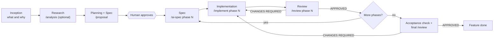

# The Spectionflow methodology

Spectionflow is **spec-driven development with an AI coding agent**. You write down what to build in a document precise enough that an agent can build it, then you check the result against that same document. The document, not the chat, is the source of truth.

This page explains the ideas. For the file layout and skill table, see [WORKFLOW.md](WORKFLOW.md). Deeper dives: [inception](inception.md), [development](development.md), [specification](specification.md).

## The problem it solves

AI agents are fast and literal. When the specification is vague, implicit or contradictory, the agent fills the gaps with plausible guesses and the code drifts from what you meant. Chat history is a poor spec: it is long, unordered, and lost when the session ends.

Spectionflow makes three moves:

1. **Decide before you build.** Ambiguity is removed in documents, where a human can review it, not in code.
2. **One document per decision stage, from coarse to fine.** The Proposal fixes what and why; the AI-SPEC of each phase fixes how. Each stage reads the previous document and writes the next, so any stage can be re-run or resumed from files.
3. **Verify against the same documents.** Review checks the code against the AI-SPEC and the Proposal's rules and acceptance criteria, with evidence.

## Humans decide, AI executes

| The human | The AI |
|---|---|
| Says what the product is and what is out of scope | Asks questions, proposes options, drafts documents |
| Approves the Proposal, and reviews each phase spec, before code is written | Explores the codebase and writes the spec from what it finds |
| Answers open questions that only a person can answer | Implements one phase at a time, exactly as specified |
| Accepts or rejects the final result | Reviews with evidence and reports findings |

Two rules follow from this:

- **Nothing is specified or implemented on an unapproved Proposal.** It moves to `Approved` only when you approve it in the conversation. A phase is implemented only from its AI-SPEC.
- **The reviewer does not fix, and the fixer does not approve.** Findings go into a review document; fixes go through `/implement`; the new verdict comes from a fresh `/review`.

## Discovery vs delivery

| | Discovery | Delivery |
|---|---|---|
| Question | Are we building the right product? | Are we building the product right? |
| Output | Decisions: pain, customer, value hypothesis, scope | Working, reviewed code |
| Failure mode | Building something nobody needs | Building the wrong thing from a vague spec |
| Spectionflow stage | Inception (and Analysis, when a feature is uncertain) | Development |

The common mistake is doing delivery before discovery. Inception exists to prevent it. You can skip it for an existing product, but then you are asserting that discovery is already done.

## The lifecycle

`/pipeline` runs everything from `/proposal` onward and stops at the human checkpoints.

### Inception

Decides **what** to build first, for **whom**, and **how you will know it worked**. Output: a product definition and a Milestone 1 scope. Details in [inception.md](inception.md). Skill: `/inception`.

### Development, per feature

Development runs once per feature (or per refactoring, or per extra feature). It has six steps, and the spec comes in two levels:

| Step | Purpose | Spectionflow |
|---|---|---|
| **Research** | Remove uncertainty: explore options, root causes, constraints. Skip it when the feature is already clear. | `/analysis` (optional). `/proposal` always does its own exploration of the code first. |
| **Planning** | Decide what and why, and break the work into phases that can be specified, built and reviewed one at a time. | `/proposal`: problem, rules, acceptance criteria, and the phase roadmap (the *Implementation Plan* section). |
| **Spec** | Write the precise, unambiguous description of how one phase is built, which an agent can implement without asking. | `/ai-spec <Feature> phase N` writes the **AI-SPEC**. See [specification.md](specification.md). |
| **Implementation** | Build one phase, in a fixed order, with tests. | `/implement <Feature> phase N` |
| **Review** | Compare code with the spec; produce a verdict. | `/review <Feature> phase N`, then `/review <Feature> final` |
| **Validation / correction** | Verify acceptance criteria, fix findings, re-review. | `/pipeline` (bounded fix loop, acceptance-criteria verification), or run `/implement` and `/review` by hand |

Planning and Spec are two documents at two levels of detail. The **Proposal** is feature-wide and stable: it says what and why and carries only a phase roadmap. The **AI-SPEC** is per phase and written just in time, against the code as it is after the previous phases: it says how, with real paths, rules as boolean expressions, guarded state machines and tests. Splitting them keeps the decision document short enough to approve, and the executable detail fresh.

## Phases and sprints

A **phase** is a slice of a feature (or of a product) that is delivered and reviewed as a unit. A phase leaves the system working and touches a bounded set of files.

In classical flows a phase is split into sprints, each implemented in turn. Spectionflow uses the phase itself as the unit: it is sized so that **one `/ai-spec`, one `/implement` and one `/review` run** cover it. If a phase is too large for that, split it in the Proposal. Each phase starts with a clean context: the agent re-reads the phase's AI-SPEC and the Proposal instead of remembering earlier work, which is why the AI-SPEC must be self-sufficient.

Quality drops on long runs. `/pipeline` warns when a plan has more than five phases and suggests batches of three or four.

## Refactoring and extra features

Not all work comes from inception. Refactorings, improvements and features nobody planned enter the flow at **Research / Spec**, not at Implementation:

- **Refactoring**: write a Proposal whose problem is the current structure, whose business rules are "behavior X must not change", and whose phases migrate step by step (each then gets its own AI-SPEC). Use `/analysis` (`rca` or `decision` mode) first if the cause or the best approach is unclear.
- **Extra feature**: if it is small and clear, go straight to `/proposal`. If it carries real uncertainty, `/analysis` first.
- **Commodity features** that inception left undefined are detailed the same way: a Proposal, or an analysis plus a Proposal.

## Comparison with other processes

**Unified Process.** Spectionflow's Inception resembles the UP *Inception* phase: justify the product, bound the scope, identify major risks. The development loop resembles *Elaboration/Construction*, with the difference that each iteration is driven by a machine-readable spec and ends with an evidence-based review rather than a demo.

**Scrum.** Rough mapping:

| Scrum | Spectionflow |
|---|---|
| Product backlog and refinement | Inception scope, and the Proposal (refinement of one feature until it is "ready") |
| Sprint planning | The phase roadmap in the Proposal, then the AI-SPEC of the next phase |
| Sprint | One phase: `/implement` then `/review` |
| Definition of Done | Acceptance criteria (`CA-...`) and the review verdict |
| Sprint review/retrospective | Review document and its deferred items |

Spectionflow has no ceremonies, time boxes or roles. The only fixed meetings are the human checkpoints: approve the Proposal, read the review, accept the result.

## Mapping to the seven skills

| Skill | Stage | Reads | Writes |
|---|---|---|---|
| `/inception` | Inception | `docs/inception/sources/` | `docs/inception/Product_Definition.md`, `Scope_and_Milestones.md`, seed proposals |
| `/analysis` | Research | project docs, code | `docs/features/<Feature>/Analysis_<Feature>.md` |
| `/proposal` | Planning | inception, analysis, code | `docs/features/<Feature>/Proposal_<Feature>.md` |
| `/ai-spec` | Spec | the approved Proposal, code | `docs/features/<Feature>/AI-SPEC_<Feature>_Phase_<N>.md` |
| `/implement` | Implementation | the AI-SPEC, the Proposal | code and tests for one phase |
| `/review` | Review | the AI-SPEC, the Proposal, the diff | `Review_Phase_<N>_<Feature>.md`, `Review_Final_<Feature>.md` |
| `/pipeline` | Orchestration, validation, correction | all of the above | `Progress_<Feature>.md` and the artifacts of the skills it calls |

## Principles in one list

1. The document is the contract; the chat is disposable.
2. Explore the real code before writing anything. Never invent paths, APIs or facts.
3. Ask when something is undefined. Record questions with an owner.
4. Small phases, each reviewable alone.
5. Every rule and criterion has an id, and ids are never renamed.
6. Evidence over assertion: a verdict cites a file, a line or a command output.
7. If a spec turns out wrong, amend the spec (keeping the original text visible), then continue.
