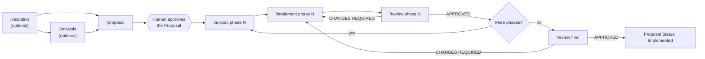

# Skills reference

Spectionflow ships seven skills. Each one reads the document written by the previous step and writes its own, so the work stays auditable and resumable.

| Skill | One-line purpose | Writes | Reference |
|---|---|---|---|
| `/inception` | Turn a product sketch into the minimum for a first milestone | `docs/inception/Product_Definition.md`, `docs/inception/Scope_and_Milestones.md`, seed proposals | [inception](inception.md) |
| `/analysis` | Study a theme before proposing a solution | `docs/features/<Feature>/Analysis_<Feature>.md` | [analysis](analysis.md) |
| `/proposal` | Write the what and why of a feature, with a phase roadmap | `docs/features/<Feature>/Proposal_<Feature>.md` | [proposal](proposal.md) |
| `/ai-spec` | Write the executable spec of one phase | `docs/features/<Feature>/AI-SPEC_<Feature>_Phase_<N>.md` | [ai-spec](ai-spec.md) |
| `/implement` | Implement one phase from its AI-SPEC (code + tests) | code, tests; edits only the `Status` lines of the Proposal and the AI-SPEC | [implement](implement.md) |
| `/review` | Verify one phase (or the whole feature) against the AI-SPEC and the Proposal | `Review_Phase_<N>_<Feature>.md`, `Review_Final_<Feature>.md` | [review](review.md) |
| `/pipeline` | Orchestrate all of the above for one feature | `Progress_<Feature>.md` and drives the other skills | [pipeline](pipeline.md) |

All produced documents are described in the [artifact reference](../artifacts.md).

## How the skills chain

- `/inception` and `/analysis` are optional. `/proposal` uses them when their documents exist.
- Two levels of spec: the Proposal is the what and why of the feature; the AI-SPEC is the how of one phase, and is what `/implement` follows.
- The human approves the Proposal before any phase is specified, and reviews each AI-SPEC before it is implemented.
- The reviewer never fixes what it finds; the fix goes back through `/implement`, and a fresh `/review` issues the new verdict.
- `/pipeline` runs this whole loop (including `/ai-spec` per phase) in one session, with a limit of 3 fix rounds per phase.

## Command cheat-sheet

| I want to... | Run |
|---|---|
| Start a product from an idea | `/inception init <name and sketch>` |
| Define pain, customer and value hypothesis | `/inception discovery` |
| Define Milestone 1 | `/inception scope` |
| Create seed proposals from Milestone 1 | `/inception finalize` |
| See what inception documents exist | `/inception status` |
| Study a theme (mode inferred) | `/analysis Notification Retry Strategy` |
| Study with an explicit mode | `/analysis Search Backend Options decision` |
| Investigate a bug's root cause | `/analysis rca Webhook signature mismatch on retry` |
| Write the proposal | `/proposal Notification_Retry` |
| Write the executable spec of a phase | `/ai-spec Notification_Retry phase 1` |
| Spec the next phase without one | `/ai-spec Notification_Retry` |
| Implement the first phase not yet implemented | `/implement Notification_Retry` |
| Implement a specific phase | `/implement Notification_Retry phase 2` |
| Review a phase | `/review Notification_Retry phase 2` |
| Review the whole feature | `/review Notification_Retry final` |
| Run everything for a feature | `/pipeline Notification_Retry all` |
| Run a single phase end to end | `/pipeline Notification_Retry phase 1` |
| Continue an interrupted run | `/pipeline Notification_Retry resume` |

## Conventions shared by all skills

- **Feature names** are `PascalCase_With_Underscores` (for example `Notification_Retry`). Features live directly under `docs/features/`; there is no module level.
- **Project discovery**: skills read your README, `CLAUDE.md` / `AGENTS.md` (if any), package or build manifests, existing code and docs. Build, test and lint commands come from the repository; when unclear, the skill asks.
- **Language**: documents are written in the language of your project docs. Section headings stay in English.
- **Dates** come from the shell `date` command, never from memory.
- **No invented facts**: every path cited in a document must exist; secrets are never transcribed (the document cites where they live, not their value).
- **Human decides**: status changes such as `Approved` happen only when you approve in the conversation.
